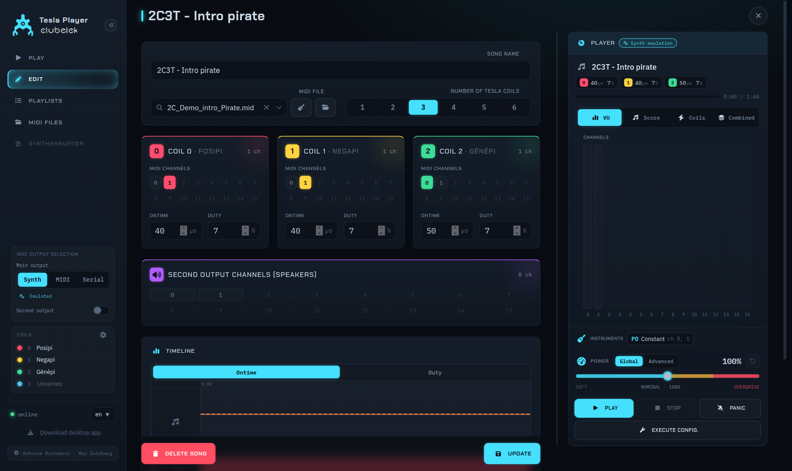

# User guide

← [Docs](./README.md) · [Project README](../readme.md)

How to play music on your Tesla coils and configure each song. This covers the web app and applies to the [desktop app](./desktop-app.md) too (same interface).

**Contents**

- [The interface at a glance](#the-interface-at-a-glance)
- [Choosing your outputs](#choosing-your-outputs)
- [Playing a song or playlist](#playing-a-song-or-playlist)
- [Live power control](#live-power-control)
- [Editing a song](#editing-a-song)
- [Playlists](#playlists)
- [The MIDI editor](#the-midi-editor)
- [Envelopes](#envelopes)
- [Backup](#backup)
- [Language](#language)

---

## The interface at a glance

- **Sidebar (left)**: navigation (Play, Edit, Playlists, Envelopes, Tuning, and Syntherrupter when connected), your **output selection**, the **coil legend**, and footer controls (connection status, and the **…** menu: language, look, desktop download / sync, the guided tour, and **About Tesla Player**, the project's pages and credits).
- **Main area**: the current screen (Play, Edit, ...)
- **Lists** (songs, playlists): a click on a column's header sorts by it (again for the other way, a third time for the list's own order); the funnel beside a header filters on that column's values (tags, coil count, playlists). The searches take the words in any order and ignore case and accents ("fur elise" finds *Für Elise*); put a phrase in quotes to keep its words together, and a minus before a word to leave out what holds it (`-classique`).
- **Guided tours**: the app tour (offered on the first visit, then in the **⋯** menu) shows how the pages fit together; the **?** beside each page's title runs that page's own, detailed tour. Both run on demo data: nothing is saved and nothing reaches the coils.
- **On a phone or a tablet** (a window under 1000 px wide), the sidebar becomes a bottom bar with the show-time pages only: **Play**, a simplified **Edit** (name, file, tags, coils; the spatialisation, the power over time and the MIDI editor stay on a large screen) and **Playlists**. **More** opens the **⋯** menu. The other pages stay reachable by their address.

## Choosing your outputs

The sidebar's **Output** section has two lines, **Coils** and **Speakers**. Each shows what is actually playing, with a light (green: a device answers; orange: the one chosen is missing). A click opens its menu, and the choice is remembered between sessions.

### Coils

The menu lists every destination in one place:

- **Emulated synth**: the built-in Web Audio emulation, for composing and previewing without hardware. It plays the notes as the board would fire them: each coil's voices, max ontime, max duty and min ontime hold, as read from the board (else as last read on this computer, else default values), and the file's volume and expression (CC7, CC11), pedals and pitch bend count. Its **timbre** is set right below it; the MIDI editor and the envelope audition use it too, whatever the output.
- **MIDI interfaces**: every MIDI output the browser sees (a USB-MIDI interface to your coil setup).
- **Syntherrupter over USB**: a **direct serial link to the Syntherrupter** (Web Serial). **Connect a USB port…** opens the browser's port picker. Once connected, a **Syntherrupter** page appears in the sidebar so you can [configure the device itself](./syntherrupter.md), and **Disconnect** goes back to the synth. A previously authorized port reconnects automatically on the next launch, and when it is plugged back in (or the device reboots).

If the coil output goes away (a USB-MIDI interface unplugged, the serial link dropped), its line turns orange and says so, playback stops, the sound falls back to the built-in synth and the player shows it in red until the output is back.

### Speakers (optional)

Pick a MIDI device to mirror selected channels to it (typically speakers playing alongside the coils), or **None**. You choose **which MIDI channels** go to it per song, and the menu's **offset from the coils** slider nudges it earlier or later to stay in sync with them (hardware interfaces have different delays).

### Coils & tags

The sidebar lists your coils with their colors and names. The pen beside the **Coils** title opens their settings: name each physical coil and set the **default coil count** used when creating new songs (with the sidebar collapsed, or on a phone, it's the **Coils** item of the **⋯** menu). This has no incidence on hardware behavior; names are just labels, and the coil count is just a default for the UI.

**Tags**, in the **⋯** menu, lists the tags that sort the songs: add, rename, recolor or delete them. A tag can also be created right from a song's tag menu.

## Playing a song or playlist

Go to **Play**:

1. Pick a **song** (or a **playlist**) from the picker.
2. Press play.
3. **Autoplay** (toggle) starts the next track automatically when one ends. The hourglass of **Up next** adds a pause between two songs (3 to 20 s), shown as a countdown you can skip or cancel.

The queue is kept: a reload, or a detour through Live or Fixed, finds it where it was, its song loaded but never started by itself. A song deleted from the library leaves it. In it, Enter plays a song, Alt+↑/↓ moves it, Delete takes it out. A song's **list** button adds it to a playlist.

**Keyboard** (the keyboard button, or **?**): Space play/pause, ←/→ 5 s back or forward, Shift+←/→ (or P/N) the previous or next song, ↑/↓ the power by 5 % (never past the 100 % lock), F stage mode.

**Stage mode** (F, or the button beside the modes): full screen, the sidebar out of the way, bigger transport and **Panic**, and the screen kept on. Esc stays **Panic** there; hold it to leave full screen.

**Fixed** sends a constant tone per coil: ontime, duty, and the firing rate on a slider (20 Hz to 2 kHz, the note it sounds beside it; the field takes any value from 1 to 5000 Hz). The link button ties coils' frequencies together: moving one moves the others, their intervals kept. It plays on the emulated synth too.

When the board's protection threshold is known (the ESP32 board), the player warns when the live power takes a coil near it, and the song editor's coil cards when the song's own settings do. A warning only: the board's protection stays the limit.

**Panic** (or **Esc** on the Play page, in every mode) stops everything at once: the coils first, by switching the Syntherrupter's modes off (the next Play, Live or Fixed start switches its mode back on), then every note on both outputs. **Stop** and **Pause** cut the coils the same way, so nothing still queued plays after them.

Leaving the Play page, or switching its mode, while a song plays (or Live or Fixed runs) asks first, as does closing or reloading the tab.

## Live power control

While a song plays you can ride the output **live**:

- **Global mode**: a single **Power** fader scales the whole performance up/down.
- **Advanced mode**: switch to per-coil control of **on-time** and **duty** for fine balancing between coils. These settings are kept from one song to the next; back in Global mode, the fader starts from the lowest of them, so that no coil jumps up.
- The **lock** beside the value holds every fader at **100 %** at most (remembered between sessions), for a show without overdrive.

Live changes are sent to the coils as the fader moves and don't alter the saved song. The values you can reach live are bounded by the coil's **hardware safety limits** on the Syntherrupter (see [Configuring the Syntherrupter](./syntherrupter.md)), not by software.

## Editing a song

Go to **Edit**: it lists your songs, with a search (name, tag or file name), **New song**, and per song its length, coils and the playlists holding it. Click a song to open it; its **⋮** menu adds it to a playlist, duplicates it, opens its notes or deletes it. Tick songs to add them to a playlist, tag them or delete them together.

A song is **its own MIDI file** plus a **per-coil configuration**: no other song plays its file, so editing it changes that song alone. **New song** starts one from a MIDI file (pick it or drop it; several files make as many songs, and a file dropped right on the list does the same), or from a copy of another song's MIDI (its notes only: the coils are yours to set).

A song opens in the **atelier**:

- **The head**: the song's name and file, its **coil count** (1–6, which the routing, the lanes and the pads follow), **Undo / Redo** (Ctrl+Z / Ctrl+Y, outside the text fields), the **⋮** menu (edit the notes, **Duplicate** the song as saved, its file included, delete it) and **Save** (or **Update**, Ctrl+S). A dot marks unsaved changes; leaving the song with some asks first.
- **The score**: the song on one time axis. Each note has the colour of the coils playing it, striped when several do (grey and dashed: no coil plays it); under the velocities, each coil's **load** as the board plays it (Duty: its notes' load against its max duty, hatched where the board shrinks them all; Ontime: its longest pulse against its max ontime). Beside it, the channels with their **role** and envelope: hover one to light its notes up. A click on the score moves the playhead, Ctrl + wheel zooms, the grip at the bottom makes the score taller (kept on this computer). Its bar holds **Edit the notes** (the [MIDI editor](#the-midi-editor)) and the player: play, stop, the time and the **Power** fader, plus Panic. The song plays as it is set here, even before saving.
- **The tools**, one at a time under the score, chosen by their tabs:
  - **Assistant**: sets the coils from the song itself (see below).
  - **Routing**: one row per channel, one pin per coil plus the speakers (the second output). Several pins on a row: the channel plays on several coils. Each row also holds the channel's role (what the Assistant follows: melody, bass, chords, counter-melody, rhythm, drums; a click corrects it) and its **envelope**, written into the song's file when you save.
  - **Coils**: one card per coil, its **On-time (µs)** and **Duty (%)**, and how the board treats its notes (its channels are set in Routing).
  - **Space** and **Dynamics**: the [spatialisation](#spatialisation) and the [power over time](#power-over-time).
  - **Info**: the name, the file (the arrow replaces it with another file: the coil settings stay, the old file is erased), and the tags (a new one can be created right there).

A new song opens on the **Assistant**; a song already set opens on its **Coils**, with **Calibrate to compare** a click away. When the server has [authentication](./authentication.md) enabled, the song records **who last edited it**, shown as a small "edited by ..." line in Info.

### The Assistant

It reads the song (each channel's register, how many notes it plays at once, how often it sounds) and the coils' limits (as the board gave them, else as it last gave them on this computer, else the app's defaults), then routes the channels and sets each coil. What it finds is saved as plain numbers, like a setting made by hand.

- **The intention**. *Clean*: every note in its place, none stuck at the max ontime (where velocity and nuance stop counting), few shrunk by the max duty the notes share, the melody 3 dB in front (a switch). *Spectacular*: the longest arcs, the max ontime on every note, the board holding the duty at its max when it saturates.
- **A role per coil**, if you want one (at the top of its pad; *Auto* by default, for this song only): the coil plays the channels of that role (the melody, the bass…), and the Assistant keeps the other lines off it unless one would go unheard. Two coils given the same role both play it. A role the song has no channel for leaves the coil to the Assistant.
- **A preset**, then **each coil's pad** to refine it: in Clean, power upwards and the crossover across (full bass on the left, even treble on the right); in Spectacular, arc length upwards and how far the bass goes (held back on the left, at the max on the right). Each spot is coloured by what it does to the coil's notes, and the reading under the pad says it in numbers.
- **The comparison** with the saved setting: the share of notes stuck at the max ontime, the notes the board shrinks, the loudness. Undo brings the saved setting back.
- It keeps **your routing** once you change it in Routing, and sets the numbers on it; *let the Assistant route* gives the routing back to it.

### Power over time

The **Dynamics** tool varies the coils' power along the song. Switch it on, then:

- **Shape the Song curve**: it sets every coil's power (100 % = the settings on the coil cards, up to 200 %). Double-click the track to add a point, drag a point to move it (it snaps to the beats of the file, hold Alt to place it freely), Delete removes the selected one. **Add at …** puts a point where the player is: pause at the chorus, one click.
- **Choose each point's transition**: *Instant* (the level jumps there) or *Gradual* (a ramp from the previous point), for rises, fades and crescendos. **Intro rise** and **Fade out** build the usual ones.
- **Per coil** adds a track per coil, for its ontime or duty: it multiplies the Song curve, for a solo or a balance that changes during the song.
- The list under the tracks holds the exact time, level and transition of every point.

What a coil gets is its setting × the Song curve × its own curve × the player's live **Power** fader: the fader always applies on top, so it stays your safety control during a show. The score's coil lanes show what each coil fires at that level.

### Spatialisation

The **Space** tool spreads the notes across the coils by position, so a melody can travel from one coil to the next. Switch it on, then:

- **Place the coils** on the stage, from left to right: drag a coil's marker (or focus it and use the arrow keys), and its reach with the diamonds on its band. **Space evenly** spreads them the way the Syntherrupter suggests.
- **Choose how a note passes from one coil to the next**: *Fade* (the volume drops with the distance, the note glides) or *One at a time* (full volume inside the reach, nothing past it).
- **Choose, per channel, where its notes sit**: the **file's pan** (CC10, the default), their **pitch** (each note, or the lowest, highest or loudest one sounding, over a note range, low notes on the left or on the right), or **everywhere** (every coil assigned the channel plays all of it).

A coil only plays the channels it is assigned: the section warns when a channel sits out of reach of all its coils (it would not play), or when it is assigned to a single coil (it cannot move). The player's **Load** view counts it in what each coil fires, and the built-in synth pans the sound left and right the same way.

The player sends the spatialisation before each song, and switches it off for songs without it (and for Live mode and tuning), so a song never inherits the previous one's.

### Worked example

In this 3-coil setup, **coils 0 and 1 play channel 1** and **coil 2 plays channel 0** of the MIDI file. The coils run at maximum on-times of **40 / 30 µs** and duty-cycles of **3 % / 2.1 %**. All 16 channels are allowed on both outputs.

## Playlists

Go to **Playlists** to group songs into an ordered set for a show (the list works like the songs': search, **New playlist**, a click opens one). A playlist targets a specific **coil count**; only songs authored for that count are meant to play. Reorder, add and remove songs, then play the playlist from the Play screen (with autoplay for a hands-off set).

## The MIDI editor

The pen next to a song's file field (or **Edit the notes** in its **⋮** menu) opens the song's notes in the **MIDI editor**:

- **Channels (left)**: each channel's **instrument**, the Program Change it starts on, so the envelope it plays on the Syntherrupter. The eye hides a channel, the speaker mutes it while listening, the bin deletes it with its notes. Click a channel's name to select its notes.
- **Selecting notes**: click, or drag a box; Shift adds, Ctrl toggles. **Select ▾** picks them by criterion, in one channel or all: shorter than a length (ghost notes), below a velocity, from or below a pitch (to split a bass from a melody), the top note of each chord or the rest, the notes beyond a number of voices at once, the same keys as the selection. Drag on the ruler to choose a **passage**: the criteria then stay inside it.
- **The selection bar** appears at the bottom while notes are selected: move them to another **channel** (they take its instrument; a free channel starts on program 0, choose its instrument in the list), **transpose** (↑ ↓, Shift for an octave), **shift** them by a grid step (← →), set or scale their **velocity** (on the Syntherrupter it is each note's power), **quantize** them (their start onto the grid, their length kept), copy, duplicate, paste at the cursor, delete.
- **Drawing**: the **Pencil** (P) adds notes on the channel chosen next to it, drag for their length. With **Select** (V), a double-click adds a note, a right-click deletes one, dragging moves the selection (on the grid, Alt for free) and a note's right edge sets its length. The lane at the bottom paints the velocity.
- **Passages**: delete one (the rest closes up) or keep it alone; **Trim** removes the silence before the first note.
- **Tempo** (in BPM, in the toolbar): the speed the file starts at. Changing it speeds up or slows down the whole song, every tempo change following in the same proportion; the notes stay on their grid.
- **Listen** (Space) plays the edit on the emulated synth, with its envelopes, from the cursor: everything, or the selection only. It never plays on the coils.
- **Undo / redo** (Ctrl+Z / Ctrl+Y). **Save** (Ctrl+S) lists what changed and, on the song's coils, the notes now on a channel no coil plays and the coils left with nothing to play.

> ⚠️ Saving rewrites the song's file: to keep the original, **Duplicate** the song first. The tempo, the controllers and the file's other events are kept.

## Envelopes

An envelope shapes a note's ontime from note-on to note-off: a sharp piano-like attack, a slow pad, a pulsation… On the Syntherrupter a channel picks one by its **program number** (a MIDI Program Change), so the channel list of the MIDI editor above is where a file chooses its envelopes.

The **Envelopes** screen lists the firmware's built-in envelopes (**P0–P19**, read-only) and your own (**P20–P63**):

- **Create** one from scratch, or **duplicate** any envelope (built-in or yours) to start from its shape.
- **Edit** it on the graph: drag each step's point (its duration and amplitude), the release point, or the note-off line to see how a shorter or longer note plays; double-click the curve to add a step there. The table below holds the exact values of each step, in playing order: amplitude (a multiplier of the note ontime, 1 = nominal), duration and curve (n-tau: 0 = linear). Add a step with **+**, remove one with its **×** (up to 7 steps, plus the release).
- **Choose what a held note does after the last step**: *Hold the level* (sustain until note-off), *Loop* from a given step (pulsation, tremolo), or *Release* straight away, even while the note is held (a one-shot). The release, played at note-off, has its own column.
- **Listen** with **Synth** (the emulation, even before saving), or **Coil**: it sends the envelope to the device and plays the note on the coil you pick, at the ontime you set, with every other coil muted.
- The screen shows which songs use the envelope, and warns before deleting or moving one they play.

Your envelopes live in the app's library (and are [synced](./desktop-app.md#synchronizing-with-a-server) like songs). The player sends the ones a song uses to the device **before each song**, so there is nothing to save on the Syntherrupter itself. The amplitude may exceed 1 for a punchier attack; the device still caps the result at the coil's [safety limits](./syntherrupter.md).

## Backup

**Backup**, in the **⋯** menu, downloads the whole library as one file: songs (with their MIDI files and tags), playlists, envelopes, tags, tunings and the coils' settings. Restoring one brings each item it holds back to its saved version, matched by its identity (a tag by its name); nothing is deleted, so what was added since stays. It asks first, then says what came back. A backup made when songs could share a file gives each song its own copy, and leaves out the files no song played.

## Tuning the primary with a camera

The **Tuning** screen helps with the "accord" of a coil: moving the primary tap so the primary resonates with the loaded secondary. Instead of judging arc length by eye between two tap positions, a phone placed on a stand measures it. The full procedure, its safety rules and what the numbers mean are in [Camera-assisted tuning](./tuning.md).

## Language

The footer language selector switches the whole UI between **English** and **French**; your choice is remembered. Want another language? See [Development → Internationalization](./development.md#internationalization).
