# User guide

← [Docs](./README.md) · [Project README](../readme.md)

How to play music on your Tesla coils and configure each song. This covers the web app and applies to the [desktop app](./desktop-app.md) too (same interface).

**Contents**

- [The interface at a glance](#the-interface-at-a-glance)
- [Choosing your outputs](#choosing-your-outputs)
- [Playing a song or playlist](#playing-a-song-or-playlist)
- [Live power control](#live-power-control)
- [Editing a song](#editing-a-song)
- [Playlists](#playlists)
- [The MIDI editor](#the-midi-editor)
- [Envelopes](#envelopes)
- [Backup](#backup)
- [Language](#language)

---

## The interface at a glance

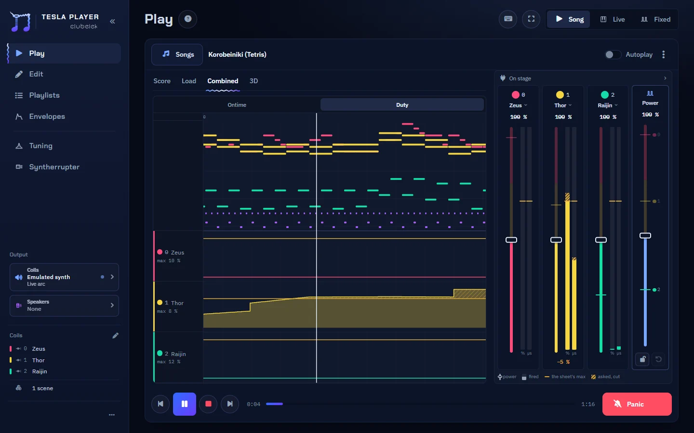

- **Sidebar (left)**: navigation (Play, Edit, Playlists, Envelopes, Tuning, and Syntherrupter, greyed with a crossed plug until the app can read the board: a serial link, or its USB-MIDI port), your **output selection**, the **coil legend**, and footer controls (**Offline**, in amber, when the server doesn't answer, and the **⋯** menu: language, look, desktop download (not on a phone) / sync, the guided tour, and **About**, the project's pages and credits).
- **Main area**: the current screen (Play, Edit, ...)
- **Lists** (songs, playlists): a click on a column's header sorts by it (again for the other way, a third time for the list's own order); the funnel beside a header filters on that column's values (tags, coil count, playlists). The searches take the words in any order and ignore case and accents ("fur elise" finds *Für Elise*); put a phrase in quotes to keep its words together, and a minus before a word to leave out what holds it (`-classique`).
- **Guided tours**: the app tour (offered on the first visit, then in the **⋯** menu) shows how the pages fit together; the **?** beside each page's title runs that page's own, detailed tour. Both run on demo data: nothing is saved and nothing reaches the coils.
- **Beginner / Expert**: the interface's level, in the **⋯** menu (**Interface**), kept on each device. A new device starts in **Beginner** (its welcome says so); one already used stays in **Expert**. Beginner hides or folds what the fine settings need, never moves anything, and caps the power at 100 %; nothing stored changes. In Edit: the song's name, tags and coils, the score with its channels and their roles, and the Assistant alone instead of the tools, without tabs: its intention and presets in plain words, the melody in front, and per coil the parts it plays and a **level** from short to long arcs (its pad's vertical axis; the numbers it stores on hover); **More settings in Expert** leads to routing, coils, space and dynamics, and what they set still plays. **Save** offers a copy first (the song's setting is the club's), replacing it is the second choice. In Play: the score and the 3D views, one power and one activity gauge per coil (no wiring menu, no duty / ontime meters), the general Power held under 100 % (no padlock), Song and Live (no Fixed mode; in Live, each coil's channels and one **power** instead of its strip and chart: the ontime and the duty together, in proportion to its sheet's maxima), the songs drawer always filtered on the coils wired. The sidebar keeps Play, Edit, Playlists and Syntherrupter, and shows a **Beginner** pill: a click switches to Expert.
- **On a phone or a tablet** (a window under 1000 px wide), the sidebar becomes a bottom bar with the show-time pages only: **Play**, a simplified **Edit** (name, file, tags, coils; the spatialisation, the power over time and the MIDI editor stay on a large screen) and **Playlists**. **More** opens the **⋯** menu; in Beginner, that tab is the **Beginner** pill. The other pages stay reachable by their address.

## Choosing your outputs

The sidebar's **Output** section has two lines, **Coils** and **Speakers**. Each shows what is actually playing, with a light (green: a device answers; orange: the one chosen is missing). A click opens its menu, and the choice is remembered between sessions.

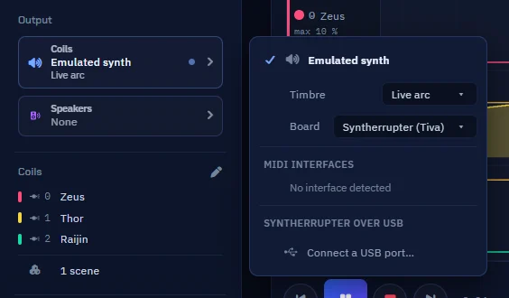

### Coils

The menu lists every destination in one place:

- **Emulated synth**: the built-in Web Audio emulation, for composing and previewing without hardware. It plays the notes as the board would fire them: each coil's voices, max ontime, max duty and min ontime hold, as read from the board (else as last read on this computer, else default values), and the file's volume and expression (CC7, CC11), pedals and pitch bend count. Its **timbre** is set right below it; the MIDI editor and the envelope audition use it too, whatever the output.
- **MIDI interfaces**: every MIDI output the browser sees (a USB-MIDI interface to your coil setup).
- **Syntherrupter over USB**: a **direct serial link to the Syntherrupter** (Web Serial). **Connect a USB port…** opens the browser's port picker. Once connected, the sidebar's **Syntherrupter** page (greyed until then) opens to [configure the device itself](./syntherrupter.md), and **Disconnect** goes back to the synth. A previously authorized port reconnects automatically on the next launch, and when it is plugged back in (or the device reboots).

If the coil output goes away (a USB-MIDI interface unplugged, the serial link dropped), its line turns orange and says so, playback stops, the sound falls back to the built-in synth and the player shows it in red until the output is back.

### Speakers (optional)

Pick a MIDI device to mirror selected channels to it (typically speakers playing alongside the coils), or **None**. You choose **which MIDI channels** go to it per song, and the menu's **offset from the coils** slider nudges it earlier or later to stay in sync with them (hardware interfaces have different delays).

### Coils & tags

The sidebar lists your coils with their names and the color of the output each is on (its fiber's cap); a click on one opens its sheet, and the pen beside the **Coils** title opens the **Coils** page (with the sidebar collapsed, or on a phone, it's the **Coils** item of the **⋯** menu). See [Coils and their sheets](#coils-and-their-sheets) below.

**Tags**, in the **⋯** menu, lists the tags that sort the songs: add, rename, recolor or delete them. A tag can also be created right from a song's tag menu.

## Playing a song or playlist

Go to **Play**. The player takes the whole page: the view (score, load, combined, 3D; in the combined one, drag the line between the score and the coils' lanes to share the height, a double click gives the default back) in the middle, one strip per output of the board on its right and the general **Power** at the end of them, and under it the transport (⏮ ▶ ⏹ ⏭), the progress and **Panic**, which stay in the same place whatever the view.

1. **Songs**, at the top left, opens a drawer over the view: the songs, the playlists, and **Up next** (the queue). Pick a **song** (or a **playlist**): the drawer closes and the song is loaded. With no song loaded, **Choose a song**, in the middle of the view, opens it too.
2. Press play.
3. **Autoplay** (toggle) starts the next track automatically when one ends. The song after this one shows at the top (a click opens the queue). The hourglass of **Up next** adds a pause between two songs (3 to 20 s), shown as a countdown you can cancel.

The **⋮** menu at the top right sends the song's settings to the coils again (**Resend the settings to the coils**).

**On stage**, the strips on the view's edge, has one strip per output of the board, in its order. Its head is the output's fiber cap and number, with the coil plugged on it: its menu swaps it or unplugs it; a dashed **+** strip plugs another coil on the first free output. Tesla Player keeps this wiring for the next time. The colors are the outputs' (each fiber has a colored cap), not the coils': if you swap the fibers, change which coil is on each output here, and the coils take their new output's color everywhere (a coil on no output is gray). The strips fold to their caps with a click on their title. When an output isn't set as the sheet of the coil wired to it (read back on connection, or unknown for a board that doesn't read back), the player asks to update the Syntherrupter from the sheets, with a before / after table per output (before: what the Syntherrupter holds, "?" when unknown; after: the coil's sheet). **Update** sets it until the board is switched off, **Update + EEPROM** also saves it to the board's EEPROM, kept at power-up, **Ignore** leaves the board as it is. Nothing is written without asking. A check beside the outputs says the board is set as the sheets. A song plays each of its coils on the output it is wired to; a coil on no output doesn't play, and gets a dashed strip with a button that plugs it on a free output. The sidebar's coil list shows each coil's output.

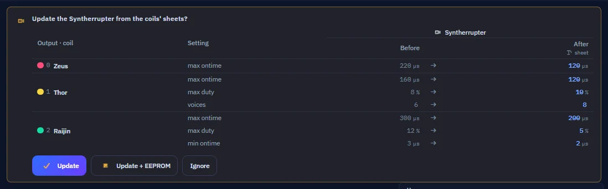

The queue is kept: a reload, or a detour through Live or Fixed, finds it where it was, its song loaded but never started by itself. A song deleted from the library leaves it. A song's **list** button adds it to a playlist.

**Keyboard** (the keyboard button, or **?**): Space play/pause, ←/→ 5 s back or forward, Shift+←/→ (or P/N) the previous or next song, ↑/↓ the power by 5 % (never past the 100 % lock), F stage mode; in **Up next**, Enter plays the song picked, Alt+↑/↓ moves it, Delete takes it out.

**Stage mode** (F, or the button beside the modes): full screen, the sidebar out of the way, the page's head down to the button that leaves it, bigger transport and **Panic**, and the screen kept on. A badge beside the song says when the emulated synth plays instead of the coils (the sidebar says it the rest of the time). Esc stays **Panic** there; hold it to leave full screen.

**Fixed** sends a constant tone per coil, switched on or off on its card: its duty (the pulse fired is duty ÷ rate; under the gauge, a line says which of the coil's limits cuts it, when one does) and the firing rate on a slider (20 Hz to 2 kHz, the note it sounds beside it; the field takes any value from 1 to 5000 Hz). The link button ties coils' frequencies together: moving one moves the others, their intervals kept. It plays on the emulated synth too.

When the board's protection threshold is known (the ESP32 board), a triangle on a strip warns when the live power takes its coil near it, and the song editor's coil cards when the song's own settings do. A warning only: the board's protection stays the limit.

**Panic** (or **Esc** on the Play page, in every mode) stops everything at once: the coils first, by switching the Syntherrupter's modes off (the next Play, Live or Fixed start switches its mode back on), then every note on both outputs. **Stop** and **Pause** cut the coils the same way, so nothing still queued plays after them.

Leaving the Play page, or switching its mode, while a song plays (or Live or Fixed runs) asks first, as does closing or reloading the tab.

## Live power control

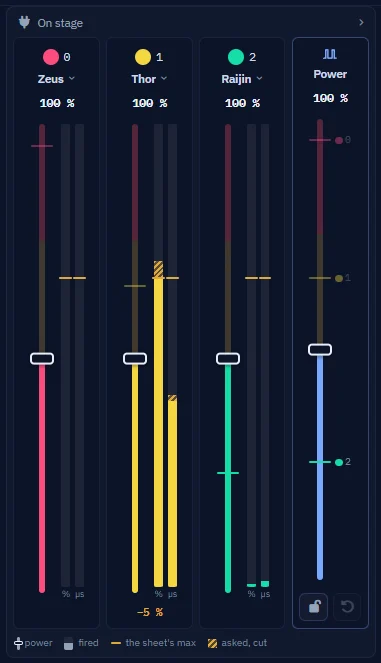

While a song plays you can ride the output **live**, ontime and duty together (100 % = as the song sets them):

- Each strip's **fader** sets its coil's own share. It follows the coil: plugged on another output, the coil keeps it; it also stays from one song to the next. Drag it (a finger too), use the arrows, or double-click it back to 100 %.
- The general **Power**, the last strip, multiplies every coil's share (never past 200 %), as a mixing desk's master: the coils keep their balance. On each strip, the colored fill and the value after the arrow (« 80 % → 40 % ») show what the coil receives, share × general Power (its tooltip: « 80 % × Power 50 % = 40 % »); the handle stays on its share.
- A mark on a coil's fader is its **notch**: when what it receives passes it, its bass is at its max ontime, and more power no longer changes it. On the general Power, the marks carry the outputs' caps: where the general Power puts each coil's bass at its cap.
- A legend under the strips says how to read them: the power, what the coil fires, its sheet's max, what was asked and cut.
- Each strip also shows what its coil fires now: its duty and its longest pulse against its limits (hatched where the board cut what was asked), the reduction the max duty forces, and, from the first note the board silences for lack of a voice, a light with their count. Its tooltip gives what the board was sent.
- The **lock**, under the general Power, holds every fader at **100 %** at most (remembered between sessions), for a show without overdrive; the reset puts every fader back to 100 %.

Live changes are sent to the coils as the fader moves and don't alter the saved song. The values you can reach live are bounded by the coil's **hardware safety limits** on the Syntherrupter (see [Configuring the Syntherrupter](./syntherrupter.md)), not by software.

## Editing a song

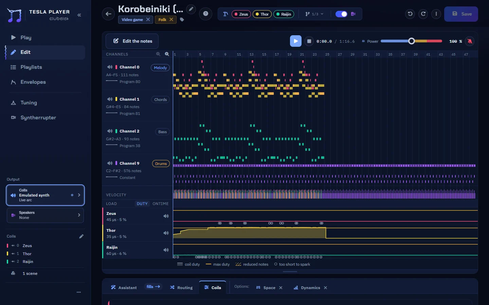

Go to **Edit**: it lists your songs, with a search (name, tag, file name or last editor), **New song**, and per song its length, coils and the playlists holding it. Its **Last edit** column gives when it last changed and by whom (sort or filter on it). Click a song to open it; its **⋮** menu adds it to a playlist, duplicates it, opens its notes or deletes it. Tick songs to add them to a playlist, tag them or delete them together.

A song is **its own MIDI file** plus a **per-coil configuration**: no other song plays its file, so editing it changes that song alone. **New song** asks its name, its MIDI file (pick it or drop it; several files make as many songs, named after their files; a file dropped right on the list opens it with the file chosen) or a copy of another song's MIDI (its notes only: the coils are yours to set), and how many coils it starts with (the first of the list; this device remembers the last choice).

A song opens in the **atelier**:

- **The head**: the song's name (the pencil beside it, or a click on it, renames it), its **tags** (the tag button adds one, and can create a new one right there), its **coils**, ticked among the inventory's (up to 6: a tick adds the coil's place at the end, an untick takes it out with its automation, spot and role; a coil on no output here can be ticked, it just won't play here; the routing, the lanes and the pads follow the places), its **variants** (the branch button beside the coils: see [Variants](#variants)), the **Speakers** switch, **Undo / Redo** (Ctrl+Z / Ctrl+Y, outside the text fields), the **⋮** menu (the file's name and length, **Replace the file** with another one: the coil settings stay, the old file is erased; **Duplicate** the song as saved, its file included, delete it) and **Save** (Ctrl+S). A dot marks unsaved changes; leaving the song with some asks first.
- **The score**: the song on one time axis. Each note has the colour of the coils playing it, striped when several do (grey and dashed: no coil plays it); under the velocities, each coil's **load** as the board plays it (Duty: its notes' load against its max duty, hatched where the board shrinks them all; Ontime: its longest pulse against its max ontime). A grey ring under a lane marks a note that isn't heard: all its pulses too short for an arc to start (or under the 4 µs the board fires), which more ontime or a longer min ontime brings out; the coil's card counts them and shades, on its chart, the zone where the coil makes no arc. Beside it, the channels with their **role** and envelope: hover one to light its notes up. A click on the score moves the playhead, Ctrl + wheel zooms, the grip at the bottom makes the score taller (kept on this computer). The keys under the charts, here and everywhere in the app, only list what the chart shows. Its bar holds **Edit the notes** (the [MIDI editor](#the-midi-editor)) and the player: play, stop, the time and the **Power** fader, plus Panic. The song plays as it is set here, even before saving.
- **The tools**, one at a time under the score, chosen by their tabs:
  - **Assistant**: sets the coils from the song itself (see below): it fills **Routing** and **Coils** (the "fills →" mark beside it), which you can touch up by hand afterwards.
  - **Routing**: one row per channel, one pin per coil plus the speakers (the second output). Several pins on a row: the channel plays on several coils. Each row also holds the channel's role (what the Assistant follows: melody, bass, chords, counter-melody, rhythm, drums; a click corrects it) and its **envelope**, written into the song's file when you save.
  - **Coils**: one row per coil, as a track. On the left, a strip like the player's: two faders, **Bass · duty** (%) and **Treble · ontime** (µs), each with its value to type, the sheet's limit padlocked on it (hatched past it) and how many of the song's notes it plays. The sheet button in the row's head opens the coil's limits (max ontime and duty, voices, min ontime) and where they come from, then its driver's: the OCD threshold and the useful ontime past which it cuts every bang (not a board limit), with a link to its full sheet. On the right, its chart in µs: the bold curve is a lone note at full velocity, the higher of the duty's slope (ontime = duty ÷ frequency, the bass) and the ontime's floor (the treble), under the max ontime; behind it, the zones where the arcs strike the ground, where none starts, and where the driver's OCD cuts the bangs before they strike (orange: the pulse sent past it is spent for nothing), and the sheet's max ontime and max duty, padlocked. The song's notes are dots at the pulse each really fired (its velocity, the chords, the limits), in the colour of what became of it: one dot a note, those of one pitch spread across its column from the song's start to its end. Drag the **bass** pill (the slope), the **treble** pill (the floor), the dot where they meet, or the crossover on the notes' axis (the ontime stays, the duty follows). Hovering a column tells everything about that note and marks its moments on the score. Its channels are set in Routing.
  - **Space** and **Dynamics**: the [spatialisation](#spatialisation) and the [power over time](#power-over-time). Both are options: while off, they are a dashed **+ Space** / **+ Dynamics** button, which turns them on and opens them; on, their tab has a **×** that turns them off (removing Dynamics' points asks first). Turned back on in the same session, they get their settings back.

A new song opens on the **Assistant**; a song already set opens on its **Coils** (the Assistant's tab shows where its setting sits on the pads, its presets a click away). When the server has [authentication](./authentication.md) enabled, the song records **who last edited it**, shown at the bottom of the **⋮** menu and in the list's **Last edit** column, with the date.

### Variants

A song maps its channels to real coils. It can be played on several sets of them, one coil, two, three or more: its own coils, and **variants** ("Posipi", "Posipi + Bobine 2", "Bobine 3 + Bobine 2"…). They share the song's file, its speakers and its channels' roles; each has its coils, their settings, its automation and its spatialisation. The branch button in the head lists them by their number of coils and opens one to edit; with several, it shows the one open and its number.

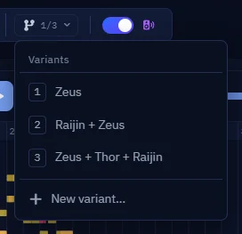

- **New variant…** starts from the one open: for each place, the same coil, another one, or none; **Add a coil** adds places. The same number of coils swapped: the routing stays, and each place's ontime and duty are worked out again for its new coil's physics, the same level aimed at as far as the new coil allows it cleanly (a large coil gets a much shorter ontime for the same loudness). Coils added or taken out: the Assistant routes the channels over the new set and sets everything again. A song can't have two variants on the same coils.
- **Rename** and **Delete** act on the variant open (the song's own coils can't be deleted). Saving the song saves all its variants; Undo goes back through them too.

On stage, the player plays the variant whose coils are all wired (another exemplaire standing in for a coil, see [Coils and their sheets](#coils-and-their-sheets)), the one with the most coils first; its settings play as they were set. A song with no variant that fits the coils wired doesn't play: the player says which coils it lacks, with a button to plug them, and the queue goes past it by itself. Edit's song list shows, for each song, how many coils its variants play on (1 · 2 · 3), in bold the one the coils wired play, their coils on hover; Play's drawer, one dot per coil of the variant that plays here. A playlist there says how many of its songs play here when some don't (« 8 of 10 play here »). The chevron at the end of a row (in Play's drawer and in Edit's list) unfolds the song without opening it: each variant, the one playing here first, with a line per coil (its dot the colour of the output it is on, dashed when it is on none), the channels it plays and its settings (bass duty, treble ontime), and icons for its spatialisation and power points; then the song's file, its speakers' channels, its playlists (in Play's drawer; Edit's list has a column for them) and its last edit. In Lecture, the song search and the playlists only show the songs that play on the coils wired now; the eye button beside them shows the others too, greyed, with what they lack.

### The Assistant

It reads the song (each channel's register, how many notes it plays at once, how often it sounds) and the coils' limits (as the board gave them, else as it last gave them on this computer, else the app's defaults), then routes the channels and sets each coil. What it finds is saved as plain numbers, like a setting made by hand.

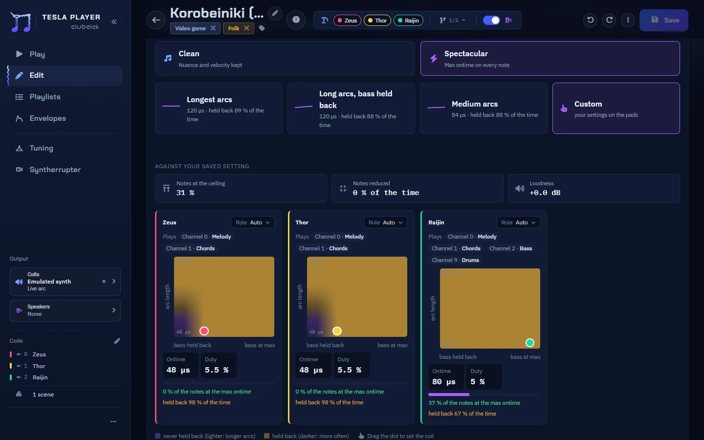

- **The intention**. *Clean*: every note in its place, none stuck at the max ontime (where velocity and nuance stop counting), few shrunk by the max duty the notes share, the melody 3 dB in front (a switch). *Spectacular*: the longest arcs, the max ontime on every note, the board holding the duty at its max when it saturates.
- **A role per coil**, if you want one (at the top of its pad; *Auto* by default, for this song only): the coil plays the channels of that role (the melody, the bass…), and the Assistant keeps the other lines off it unless one would go unheard. Two coils given the same role both play it. A role the song has no channel for leaves the coil to the Assistant.
- **A preset**, then **each coil's pad** to refine it: in Clean, power upwards and the crossover across (full bass on the left, even treble on the right); in Spectacular, arc length upwards and how far the bass goes (held back on the left, at the max on the right). Each spot is coloured by what it does to the coil's notes, and the reading under the pad says it in numbers.
- **The comparison** with the saved setting: the share of notes stuck at the max ontime, the share of the time the board shrinks the notes, the loudness; the saved value shows under a figure only when it differs. Undo brings the saved setting back.
- It keeps **your routing** once you change it in Routing, and sets the numbers on it; *let the Assistant route* gives the routing back to it.

### Power over time

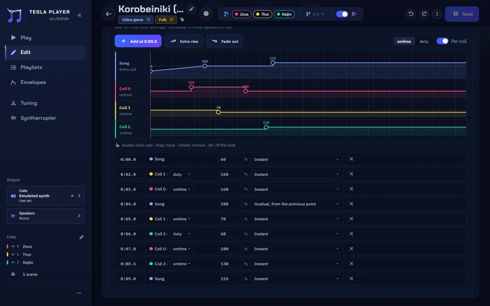

The **Dynamics** tool varies the coils' power along the song. Turn it on (**+ Dynamics** among the tool tabs), then:

- **Shape the Song curve**: it sets every coil's power (100 % = the settings on the coil cards, up to 200 %). Double-click the track to add a point, drag a point to move it (it snaps to the beats of the file, hold Alt to place it freely), Delete removes the selected one. **Add at …** puts a point where the player is: pause at the chorus, one click.
- **Choose each point's transition**: *Instant* (the level jumps there) or *Gradual* (a ramp from the previous point), for rises, fades and crescendos. **Intro rise** and **Fade out** build the usual ones.
- **Per coil** adds a track per coil, for its ontime or duty: it multiplies the Song curve, for a solo or a balance that changes during the song.
- The list under the tracks holds the exact time, level and transition of every point.

What a coil gets is its setting × the Song curve × its own curve × the player's live **Power** fader: the fader always applies on top, so it stays your safety control during a show. The score's coil lanes show what each coil fires at that level.

### Spatialisation

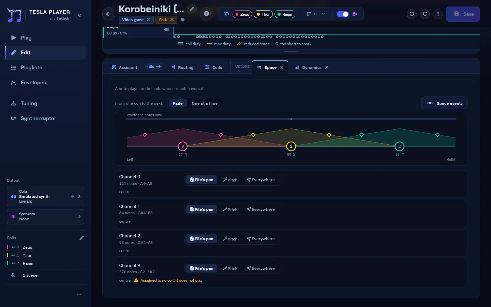

The **Space** tool spreads the notes across the coils by position, so a melody can travel from one coil to the next. Turn it on (**+ Space** among the tool tabs), then:

- **Place the coils** on the stage, from left to right: drag a coil's marker (or focus it and use the arrow keys), and its reach with the diamonds on its band. **Space evenly** spreads them the way the Syntherrupter suggests.
- **Choose how a note passes from one coil to the next**: *Fade* (the volume drops with the distance, the note glides) or *One at a time* (full volume inside the reach, nothing past it).
- **Choose, per channel, where its notes sit**: the **file's pan** (CC10, the default; its value is beside it: centre, a position, or the range it moves over), their **pitch** (each note, or the lowest, highest or loudest one sounding, over a note range, low notes on the left or on the right), or **everywhere** (every coil assigned the channel plays all of it).

A coil only plays the channels it is assigned: the section warns when a channel sits out of reach of all its coils (it would not play), or when a channel meant to move (placed by pitch, or whose pan moves in the file) is assigned to a single coil (it cannot move). The player's **Load** view counts it in what each coil fires, and the built-in synth pans the sound left and right the same way.

The player sends the spatialisation before each song, and switches it off for songs without it (and for Live mode and tuning), so a song never inherits the previous one's.

### Worked example

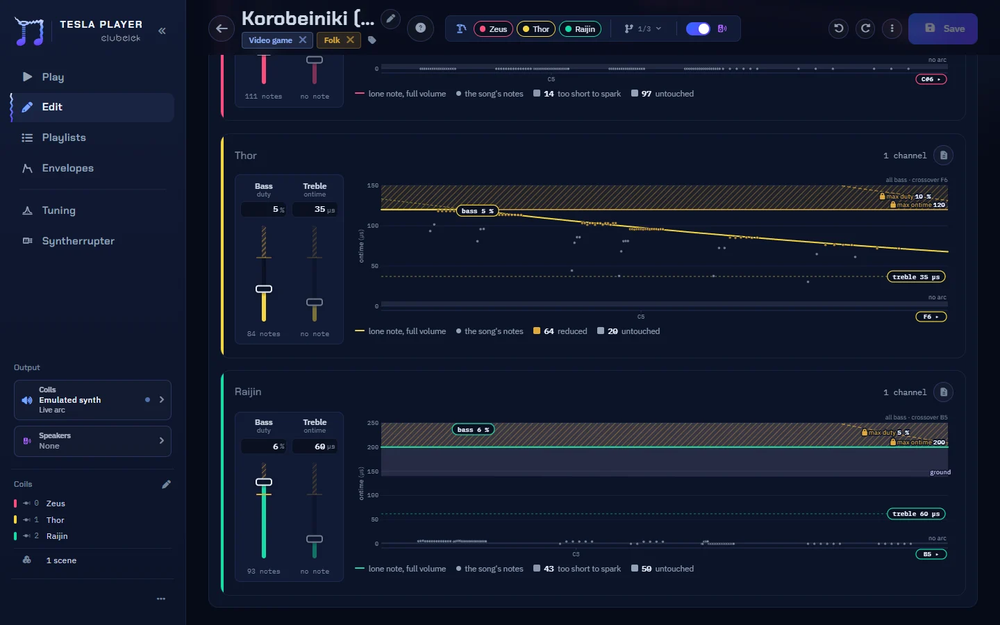

The guided tour's *Korobeiniki* in the **Coils** tool, one row per coil. On the left, the coil's two faders, **Bass · duty** and **Treble · ontime**, and how many of the song's notes it plays. On the right, its chart: the bold line is a lone note at full velocity, the dots are the song's notes at the pulse each really fired, the padlocks the sheet's max ontime and max duty, hatched past them; the key under the chart counts the notes reduced, too short to spark or untouched.

## Playlists

Go to **Playlists** to group songs into an ordered set for a show (the list works like the songs': search, **New playlist**, a click opens one). A song of a playlist plays when one of its [variants](#variants) fits the coils wired now; the others are marked (with what they lack), and **Play all** leaves them out. In the list, **Songs** gives each playlist's count, as `8 / 10` in amber when some will be skipped. In a playlist, the pencil beside its name (or a click on the name) renames it, and **Play here** shows only the songs that fit the coils wired. Reorder, add and remove songs, then play the playlist from the Play screen (with autoplay for a hands-off set).

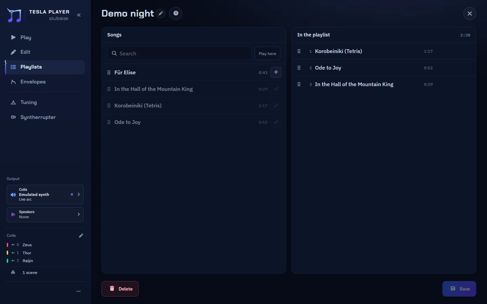

## The MIDI editor

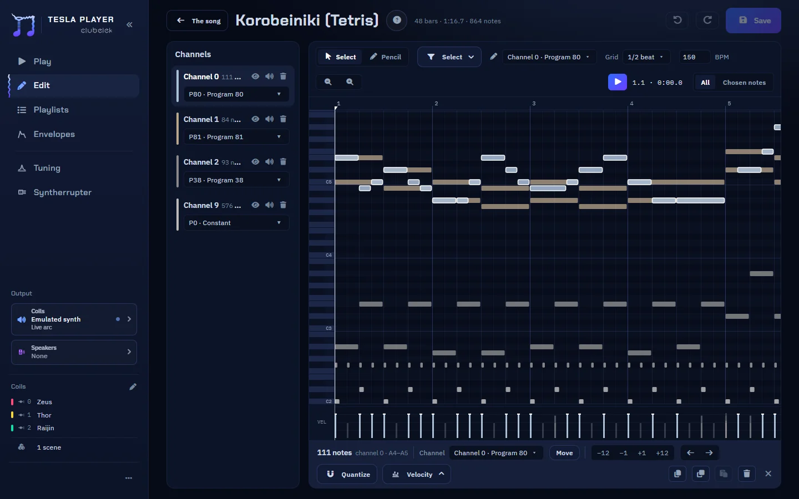

**Edit the notes**, on the score's bar in the atelier (or in a song's **⋮** menu in the list), opens the song's notes in the **MIDI editor**:

- **Channels (left)**: each in its own grey tint (the bright colors are the outputs' fiber caps), with its **instrument**, the Program Change it starts on, so the envelope it plays on the Syntherrupter. The eye hides a channel, the speaker mutes it while listening, the bin deletes it with its notes. Click a channel's name to select its notes.
- **Selecting notes**: click, or drag a box; Shift adds, Ctrl toggles. **Select ▾** picks them by criterion, in one channel or all: shorter than a length (ghost notes), below a velocity, from or below a pitch (to split a bass from a melody), the top note of each chord or the rest, the notes beyond a number of voices at once, the same keys as the selection. Drag on the ruler to choose a **passage**: the criteria then stay inside it.
- **The selection bar** appears at the bottom while notes are selected: move them to another **channel** (they take its instrument; a free channel starts on program 0, choose its instrument in the list), **transpose** (↑ ↓, Shift for an octave), **shift** them by a grid step (← →), set or scale their **velocity** (on the Syntherrupter it is each note's power), **quantize** them (their start onto the grid, their length kept), copy, duplicate, paste at the cursor, delete.
- **Drawing**: the **Pencil** (P) adds notes on the channel chosen next to it, drag for their length. With **Select** (V), a double-click adds a note, a right-click deletes one, dragging moves the selection (on the grid, Alt for free) and a note's right edge sets its length. The lane at the bottom paints the velocity.
- **Passages**: delete one (the rest closes up) or keep it alone; **Trim** removes the silence before the first note.
- **Tempo** (in BPM, in the toolbar): the speed the file starts at. Changing it speeds up or slows down the whole song, every tempo change following in the same proportion; the notes stay on their grid.
- **Listen** (Space) plays the edit on the emulated synth, with its envelopes, from the cursor: **All**, or the **Chosen notes** only. It never plays on the coils.
- **Undo / redo** (Ctrl+Z / Ctrl+Y). **Save** (Ctrl+S) lists what changed (the number of notes when it changed) and warns about the notes now on a channel no coil of the song plays and the coils left with nothing to play.

> ⚠️ Saving rewrites the song's file: to keep the original, **Duplicate** the song first. The tempo, the controllers and the file's other events are kept.

## Envelopes

An envelope shapes a note's ontime from note-on to note-off: a sharp piano-like attack, a slow pad, a pulsation… On the Syntherrupter a channel picks one by its **program number** (a MIDI Program Change), so the channel list of the MIDI editor above is where a file chooses its envelopes.

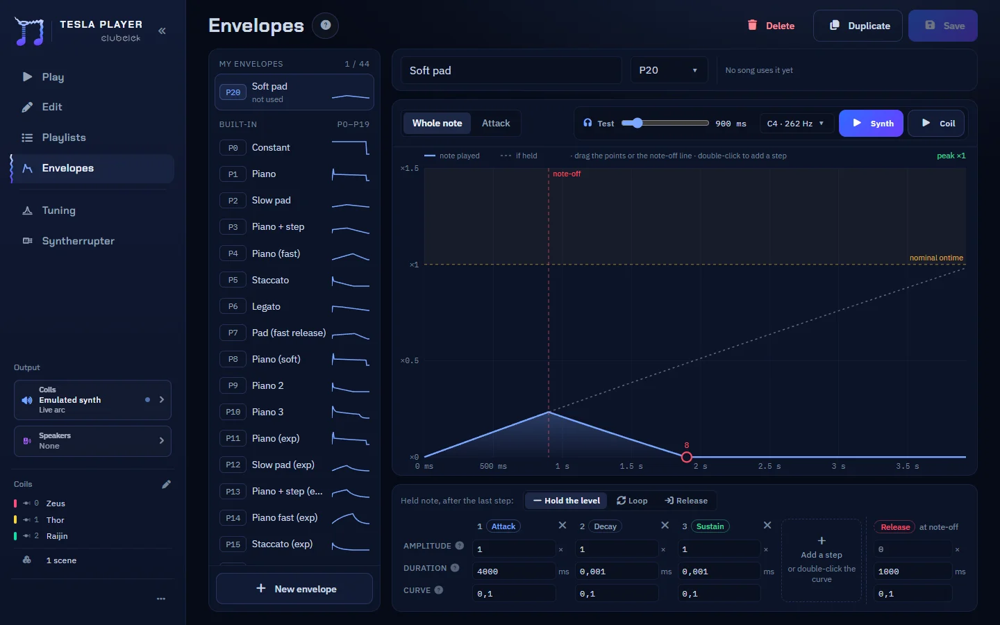

The **Envelopes** screen lists the firmware's built-in envelopes (**P0–P19**, read-only) and your own (**P20–P63**):

- **Create** one from scratch, or **duplicate** any envelope (built-in or yours) to start from its shape.
- **Edit** it on the graph: drag each step's point (its duration and amplitude), the release point, or the note-off line to see how a shorter or longer note plays; double-click the curve to add a step there. The table below holds the exact values of each step, in playing order: amplitude (a multiplier of the note ontime, 1 = nominal), duration and curve (n-tau: 0 = linear). Add a step with **+**, remove one with its **×** (up to 7 steps, plus the release).
- **Choose what a held note does after the last step**: *Hold the level* (sustain until note-off), *Loop* from a given step (pulsation, tremolo), or *Release* straight away, even while the note is held (a one-shot). The release, played at note-off, has its own column.
- **Listen** with **Synth** (the emulation, even before saving), or **Coil**: it sends the envelope to the device and plays the note on the coil you pick, at the ontime you set, with every other coil muted.
- The screen shows which songs use the envelope, and warns before deleting or moving one they play.

Your envelopes live in the app's library (and are [synced](./desktop-app.md#synchronizing-with-a-server) like songs). The player sends the ones a song uses to the device **before each song**, so there is nothing to save on the Syntherrupter itself. The amplitude may exceed 1 for a punchier attack; the device still caps the result at the coil's [safety limits](./syntherrupter.md).

## Coils and their sheets

Each coil of the **Coils** page is a real coil of the club, as many as you have. Each has a row, on scales shared by all of them so they compare: its working frequency under its name, then two bars and its volume. **Arcs at its max**: from the treble's (C7) to the bass's, the ground mat marked, violet past it. **Pulse** (at A3): no arc under the first threshold, the arcs in the air, from where they strike the mat (the OCD trips with them), up to the sheet's max ontime, padlocked, hatched past it. **Volume**: the power into its arcs at its max, in dB under the loudest coil's. A coil's colour (its output's fiber cap) is only on its cap and edge: the bars' colours say what happens, the key under the rows names them. Its **⋮** menu moves a coil up or down, duplicates or deletes it; the number on a card is the output the coil is on. A song names its coils (ticked in its head); the songs saved before that play the inventory's coil *k* at their place *k* until they are saved again.

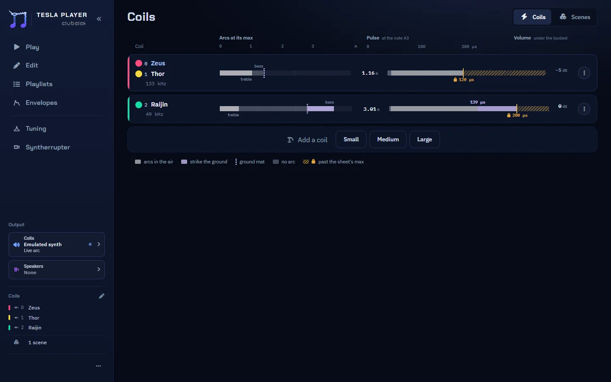

A click on a card opens its **sheet**. **Add a coil** offers three sizes, **Small**, **Medium** and **Large**: they only give the new coil its first values (the small one is the Ampère museum's coil, like the club's two small ones; the large one, the club's, estimated where its specs aren't known yet), to replace with its own. **Import JavaTC 3D**, in the sheet's ⋮ menu, fills it from JavaTC's saved output. The sheet only asks what the model uses:

- **Dimensions**, on a side view to scale (the same coil as the 3D draws): each size on the dimension line it measures, the topload's rings, the secondary, the primary and its height above the ground mat (which sets the arc length that strikes it);
- **Supply**: the bridge, the bus voltage, the OCD threshold;
- **Resonance**: the secondary's frequency, its top capacitance (empty: Kaizer's rule), the MMC, L1 at the tap used (empty: tuned 6.5 % under the secondary) and the coupling; the coil's own frequency beside them;
- **Board limits**, proposed to the Syntherrupter's config for this coil: max ontime, max duty, min ontime, voices, and the min offtime if you set it (empty, « auto »: the board's stays).

**Exemplaires**: coils built alike (the club's two small ones, or more) are one config. In the list they share a row: each its cap and name, one set of bars. Its ⋮ menu adds an exemplaire (a coil with the same config, its own name and output), makes a row take another's config (**Same config as…**, confirmed: its sheet is replaced), splits one off (it keeps a copy of the config) or deletes one. Saving an exemplaire's sheet saves the config to all of them; their names and notes stay their own. Exemplaires declared before they had one config are marked « sheets differ », and the menu makes them all take one's. When a song's coil is on no output, another exemplaire plays in its place, on its own output and with the song's settings, and the player says so.

Beside the sheet, the model at a play point, a note and an ontime: the coil in **3D** with its arcs as long as the model gives them and a dashed ring around the tube's tip as far as they reach (drag to turn, wheel to zoom; a strike on the mat, when the model says the arcs reach it, is one bright lasting channel). **Arc by ontime** is the ontime's slider: its track says what each ontime does at the note (no arc, in the air, the OCD cuts, the arcs strike the mat, blocked past what the board sends), the arc's reach above it up to the mat. The board's max ontime is a padlocked handle on the same ruler (the Max ontime field); **limit → N µs** sets it just short of the mat or of the OCD. **Power by note**: each note's power into the arcs at that ontime, about how loud it plays; a click picks the note, and a note whose max duty holds the ontime under the board's max says where. The primary current during a bang, the energies and the voltages are on **The calculations**. Three arcs bound the discharge physics (slow and thin, middle, fast and thick: the reach's spread on the ruler); the middle one finds the large coil's ~3 m. Nothing is measured on the club's coils yet. On a phone the picture stays on top, Results and Sheet two tabs sliding over it.

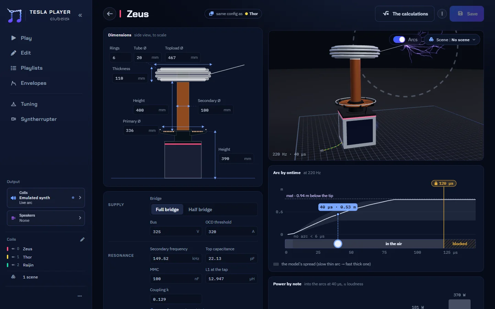

In the 3D views (the sheet's and the player's), the coils stand in a dark hall with a light haze, lit by their own arcs: a violet light that follows them and flickers with the bangs, a flash where they strike. The arcs grow in the field of the coil's top: they fan out from the tube's tip, push each other apart, and bend toward the mat when it draws them; brightest at their root, paler toward their ends. An image holds the bangs of the last 20 ms (up to 6 for a lone coil, fewer on a stage), the way the eye sees them together, which fills the high notes out; a bang takes the last one's path again while the air still holds it. The tube's tip glows with a faint corona and a few small leaks on its bevel, now and then along the tube or on the topload's rim. A strike jumps straight down its last centimetres, splits into a few feet, lights a spot on the mat, and short streamers rise around it; on a scene's ring or counter-point, it jumps onto the point nearest the tube, which answers with a small brush; on a cage, onto its mesh. The streamers' colour follows each bang's energy: violet for a short pulse, white at the board's max ontime.

The coils are drawn with their parts: the base's box, the primary on eight arms around a hub with a strike rail in their hooks, its tap's clamp underneath and its lead going down into the box; the varnished secondary; the topload's rings on 5 arms around a hub on the secondary (a torus closes its hole with a disc); a band under the box's lid in its output's fiber cap colour (grey when unplugged); three lamps on the box's front: green (powered, always on), blue (it receives notes), red (its OCD trips, as the model says), the last two with a halo when lit; the ground mat as a wire mesh in its frame, bonded to the base by a green and yellow cable, like a scene's ring. In the player's 3D, the pointer on a coil names it and its output; a click opens its sheet. On a busy or slow machine the 3D lightens itself (fewer bangs per image, fewer images, then fewer pixels) and comes back when there is room: the music keeps its timing first.

**Scenes**, the Coils page's second tab (`/coils/scenes`), pose the club's coils for the 3D views. The tab lists the scenes as cards; **+ New scene** starts one in the décor picked (a coiler's lab, a concert stage, a cyclorama studio) with the wired coils side by side. A card opens its scene on a page of its own: its name and décor at the top, with undo / redo (Ctrl+Z, Ctrl+Y), ⋮ (duplicate, delete) and **Save** (Ctrl+S).

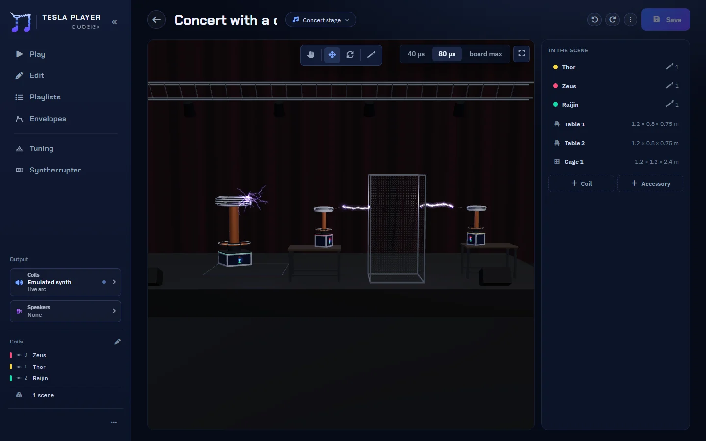

Over the picture, the tools say what a drag on a coil, a table or a cage does: **View** (V) turns the view, **Move** (D) and **Turn** (R) take it (two arrows on the floor move it across the stage or toward the audience, a notched dial turns it; Shift: along one axis, to the degree; the arrow keys nudge the chosen one), **Outlet points** (P) shows the points' handles: a point's ball takes it around the toroid and out, the arrow past it tilts it. The accessories' handles show with every tool but the view's: a ring's cube sizes it, a table's, a cage's or a counter-point's cubes size it, the arrows raise them. A click on nothing lets go of the chosen one. A right drag pans the view, F reframes it, Esc lets go, Delete removes. At the right of the picture, the setting the coils fire at.

The panel at the right lists the scene's coils and its things on the floor; **+ Coil** and **+ Accessory** add them. A coil's own settings hold its outlet points (the coil's sheet no longer has any: it keeps a default one for its figures) and its **ground ring** (Ø 35 tube, its counter-points aimed at the toroid's rim; "+ Ground ring" while it has none). An accessory is one of the scene's: a **table** (added under the chosen coil), a **Faraday cage** (grounded mesh, its floor left open: a person stands in it under a hung coil), a **counter-point** (a grounded rod on a pole, its length, height and direction; each coil's arcs meet the nearest; added facing the chosen coil's first point) or a **Faraday knight** (someone in a mail suit, grounded, who dances the Macarena; the arcs may land on their helmet). A coil whose middle is over a table stands on it and goes with it when the table moves or turns; its strikes then go down to the floor. Under the list, the chosen one to the millimetre: a coil's pose (Standing / Hung, x, z, rotation), its outlet points (a chip each; + adds one in the widest gap, +↑ an upright one at the centre; the chosen one's angle, length, tilt and Ø), its ground ring (× removes it); a table's or a cage's place and size. With no tube the arcs leave the crown, if the top reaches its breakout: grounded points (the ring's, a counter-point) break out sooner, toward it, and start the gap. Each tube fires from its own breakout, all on the same top: the more tubes, the shorter each one's arcs. The nearest grounded thing (mat, ring, counter-point, cage) takes the strikes.

The 3D views pick a scene in their **Scene** menu (kept on each device): a sheet's lists the scenes its coil is in (the scene's other coils stand silent around it), the player's lists them all, those that pose the most of the song's coils first (a dot per coil of the song, full when the scene poses it; the song's coils that the scene doesn't pose stand in front, where they would be without it). For now a scene only changes the picture: the simulation, the synth and the Assistant keep each sheet's one tube and its mat; in the player, each posed tube's arcs stretch the simulated channel as the model does at a reference setting.

**The calculations**, the button in a sheet's head, opens that coil's page (`/coils/<id>/calculs`, at the note chosen on the sheet; the arrow goes back to its sheet). A figure of the sheet (frequency, arcs, energy, top voltage, useful ontime) opens it on the line that works that figure out, lit a moment. It details how each of its figures is worked out, step by step: the coupled circuit, the bridge, the arc's start, the arc, the ground strike, a held note, then what the sheet and the list show and what the player reads while playing. Each quantity is a typeset equation: its formula, the same with the coil's numbers at the note picked at the top, and its value; a value typed on the sheet is marked « sheet ». It shows the saved sheet, not changes still unsaved. The sheet's two charts sit in the steps they belong to.

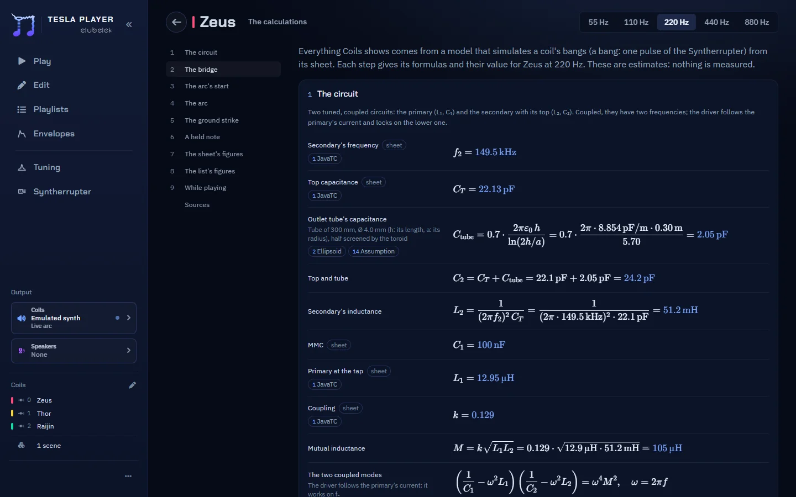

Under each quantity, its sources: numbered tags that lead to their entry in the **Sources** list at the end. Each entry says what the source gives and what the model takes from it, lists its references (authors, title, where, when) with links that open them in a new tab, and links back to every quantity that cites it. What no source gives (the 6.5 % tuning, the tube's screening, the struck channel…) is cited as an **Assumption**, and the 3 m of the club's big coil as the **Calibration**.

## Backup

**Backup**, in the **⋯** menu, downloads the whole library as one file: songs (with their MIDI files and tags), playlists, envelopes, the coils and their sheets, tags, tunings and settings. Restoring one (**Restore from a file…**) brings each item it holds back to its saved version, matched by its identity (a tag by its name); nothing is deleted, so what was added since stays. It asks first, then says what came back. A backup made when songs could share a file gives each song its own copy, and leaves out the files no song played.

## Tuning the primary with a camera

The **Tuning** screen helps with the "accord" of a coil: moving the primary tap so the primary resonates with the loaded secondary. Instead of judging arc length by eye between two tap positions, a phone placed on a stand measures it. The full procedure, its safety rules and what the numbers mean are in [Camera-assisted tuning](./tuning.md).

## Language

The footer language selector switches the whole UI between **English** and **French**; your choice is remembered. Want another language? See [Development → Internationalization](./development.md#internationalization).
