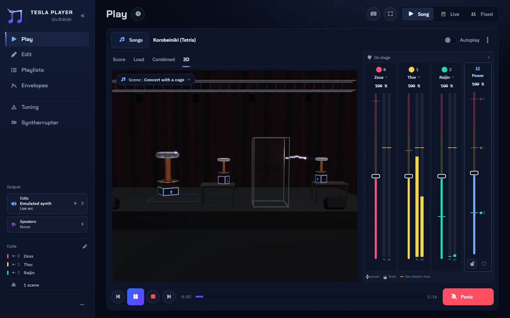

# Tesla Coil Player

A MIDI player for **musical Tesla coils** driven by [MMMZZZZ's Syntherrupter](https://github.com/MMMZZZZ/Syntherrupter), a polyphonic, multi-coil interrupter. You set each song up once per coil (which MIDI channel goes to which coil, ontime, duty cycle), then play your library on the coils during a show, with live power control.

**[Website](https://antoinercbs.github.io/tesla-synth-web-player/)** · **[Download](https://antoinercbs.github.io/tesla-synth-web-player/download)** · **[Documentation](https://antoinercbs.github.io/tesla-synth-web-player/docs)**

It was built for the high-voltage team of the [Clubelek](https://clubelek.fr) (the electronics & robotics club of INSA Lyon) and its three Tesla coils. One app prepares the songs and runs the show, where the team used to juggle a MIDI editor, SysEx commands and the board's touchscreen.



## What it does

- **Play** a MIDI library on the coils, with playlists, autoplay and a **live power** knob (or each coil's ontime and duty) to ride during a show.
- **Set each song up per coil**: map MIDI channels to coils, set ontime and duty cycle, and let them change during the song. The **Assistant** proposes a setup from the song and the coils' limits, clean or spectacular, then a pad per coil refines it.
- **Drive the output three ways**: the built-in **Tesla coil sound emulation** (to compose without hardware), a **MIDI device**, or a **two-way USB serial link** to the Syntherrupter.
- **Configure the Syntherrupter over USB**: read its settings back, edit each coil's safety limits, the system settings and the user accounts, then save to EEPROM or reboot.
- **Tune the primary with a camera**: a phone or webcam measures the arc length while the app holds test notes on one coil. The app compares the trials per tap position, suggests the next one, and saves each tuning with its place and weather. See [Camera-assisted tuning](docs/tuning.md).
- A **second output** (speakers, for example) with a per-channel filter and a latency offset.
- One **MIDI file per song**, with a **MIDI editor** (select notes in bulk to change their channel and instrument, transpose, set velocity, draw notes, cut passages) and an **envelope editor** for your own Syntherrupter envelopes (programs 20–63), heard on the emulation or a coil before saving.
- A **desktop app** (Linux, Windows) that runs offline and can **sync** with a server.
- Optional **OIDC login** (Keycloak), and an **English / French** interface.

> ⚠️ The player uses the **WebMIDI** and **Web Serial** APIs, so its web version needs a **Chromium-based browser** (Chrome, Edge, Opera…). Firefox and Safari are not supported.

## Standalone desktop app

Download the latest build for your system from the [site's Download page](https://antoinercbs.github.io/tesla-synth-web-player/download), or any version from the [releases page](https://github.com/antoinercbs/tesla-synth-web-player/releases). See [Desktop app](./docs/desktop-app.md).

## Server/Web version: Quick start (Docker)

The CI publishes an image to the GitHub Container Registry:

```bash
docker run -d --name tesla-player \
  -p 5000:5000 \
  -v tesla-data:/data \
  ghcr.io/antoinercbs/tesla-synth-web-player:latest
```

Open **http://localhost:5000**. The `tesla-data` volume keeps the songs, playlists and uploaded MIDI files.

To build from source, run `docker compose up --build`. **[Deployment](./docs/deployment.md)** covers the published image, reverse proxies and CI.

## Documentation

| Guide | For | What's inside |
| --- | --- | --- |
| **[User guide](./docs/user-guide.md)** | Everyone | Playing, live power control, editing per-coil configs, playlists, MIDI files, outputs |
| **[Syntherrupter over USB](./docs/syntherrupter.md)** | Operators | The serial config page (safety limits, system, users) + Linux serial setup |
| **[Desktop app](./docs/desktop-app.md)** | Everyone | Installing the offline app, syncing with a server, signing in |
| **[Deployment](./docs/deployment.md)** | Admins | Docker / GHCR image, Compose, data & volumes, reverse proxy, desktop downloads, GitHub Actions |
| **[Authentication](./docs/authentication.md)** | Admins | Optional OIDC (Keycloak) setup |
| **[Development](./docs/development.md)** | Contributors | Dev servers, stack, building, desktop binaries, contributing |

## Tech stack

Vue 3 + Vite + TypeScript front-end; NestJS + TypeORM (SQLite) back-end serving the API and the built front on one port; Electron for the desktop build. Details in **[Development](./docs/development.md)**.

## Contributing

The project is open source under the MPL 2.0. Pull requests are welcome, and so are feature requests and comments in GitHub issues. Translating needs no programming: see the [Development guide](./docs/development.md#internationalization).

## LLM notice

I design this app's architecture from end to end, from the high-level structure down to the low-level details. I also decide what it does, how it looks, which physical model a coil gets and which sources back it, and I test it. This is a software engineering project as practiced in 2026, not vibe coding. My rule: I accept no code I don't understand or couldn't write myself. AI saves time: by hand, this much code would have been too laborious to write.

- **Code.** Building IoT applications has been my job since I graduated several years ago. LLMs have only been good enough to help in that work for a few months. Since then, ([Claude Code](https://claude.com/claude-code)) has been one of my tools to write code faster. That speed lets a small club project offer what a show needs: a coil model, a 3D view, a desktop app.
- **Documentation.** It is mine. The LLM helps translate it from French into English, proofreads it and keeps it in step with the code.

Using an LLM doesn't mean trusting it with the coils:

- **The board enforces the limits.** The Syntherrupter's own firmware caps each output's ontime and duty and holds its minimum offtime, whatever the app plays. The app writes these limits only when you ask, with the values from the coil sheet you filled in.
- **I design and supervise the sensitive parts.** The link to the board sits in a few small typed modules, and each setting is declared once from the Syntherrupter's command reference (Syfoh) with its unit, range and safety flag. The app asks before writing a setting that touches safety, and asks twice for the output polarity.
- **Sources back the physics.** Each formula of the coil model lists its references, and the app marks as an assumption anything no source gives ([Coils and their sheets](./docs/user-guide.md#coils-and-their-sheets)).

Pull requests written with AI help are welcome under the same rule: send only what you understand and could have written yourself, once you have read the change and tried it.

## Credits

- [MMMZZZZ's Syntherrupter](https://github.com/MMMZZZZ/Syntherrupter): the open-source Tesla coil interrupter this player drives.
- [MMMZZZZ's Syfoh](https://github.com/MMMZZZZ/Syfoh): the SysEx command format reference.
- [Ryoyakawai's smfplayer](https://github.com/ryoyakawai/smfplayer): Standard MIDI File parsing.

## License

See [LICENSE](./LICENSE).
